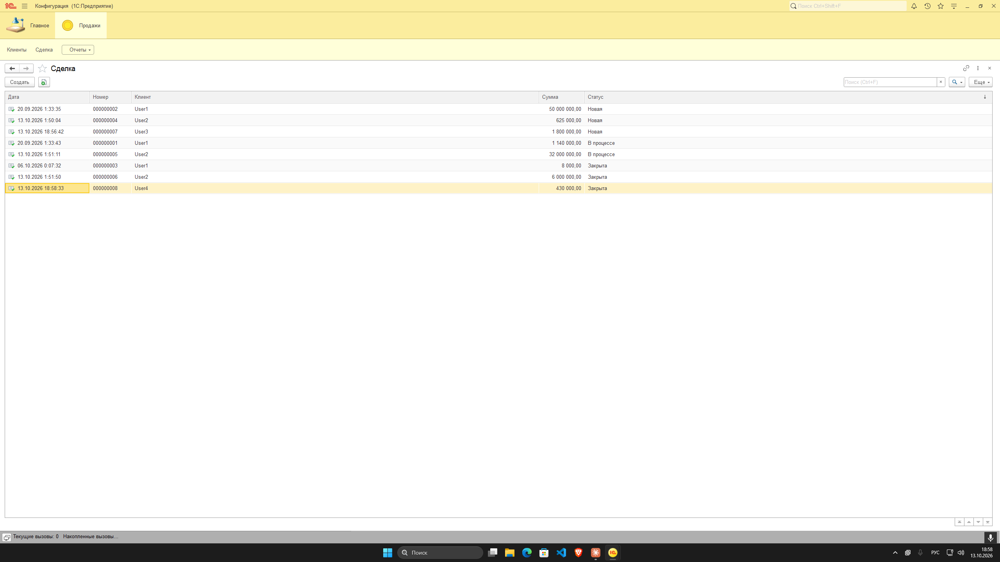
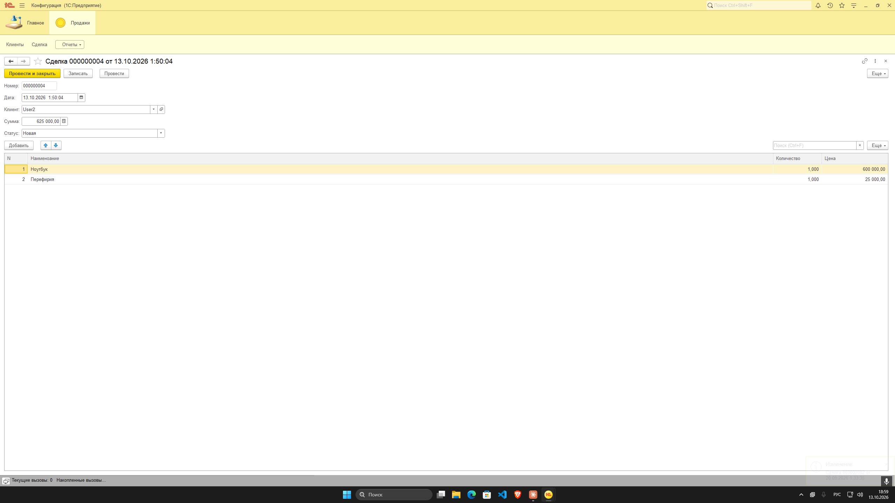
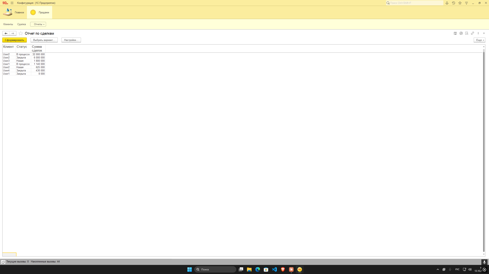

# CRM на 1С:Предприятие 8: клиенты и сделки

Учебный проект на платформе 1С:Предприятие 8 (управляемые формы). Простая CRM: учёт клиентов, сделок с товарами и отчёты по продажам.

## Объекты конфигурации

| Тип | Объект | Назначение |
|---|---|---|
| Справочник | `Клиенты` | Список клиентов |
| Документ | `Сделка` | Сделка с клиентом, табличная часть `Товары` (наименование, количество, цена) |
| Перечисление | `СтатусыСделки` | Новая, В процессе, Закрыта |
| Подсистема | `Продажи` | Командный интерфейс: клиенты, сделки, отчёты |
| Отчёт | `ОтчетПоСделкам` | Список сделок (СКД) |
| Отчёт | `СуммыСделокПоКлиентам` | Суммы сделок в разрезе клиентов (СКД) |
| Отчёт | `ПримерыЗапросов` | Учебные примеры запросов |

## Что показано в проекте

- Справочник и документ с табличной частью
- Перечисление и использование его значений в коде
- Подсистема и командный интерфейс
- Модуль объекта: обработчик `ПередЗаписью`
  - автоматический расчёт суммы по строкам (`Количество * Цена`)
  - проверка: сумма сделки должна быть больше нуля
  - проверка: клиент должен быть выбран
  - статус «Новая» по умолчанию
- Модуль формы: `ПриСозданииНаСервере` проставляет статус при создании сделки
- Отчёты на системе компоновки данных (СКД) с языком запросов 1С

## Скриншоты

## Как запустить

1. Создайте пустую информационную базу в 1С:Предприятие.
2. Откройте её в Конфигураторе.
3. Конфигурация → Загрузить конфигурацию из файлов, укажите папку репозитория.
4. Обновите конфигурацию базы данных (F7) и запустите 1С:Предприятие (F5).

## Платформа

1С:Предприятие 8.3, управляемые формы.
